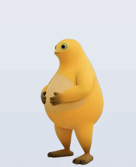
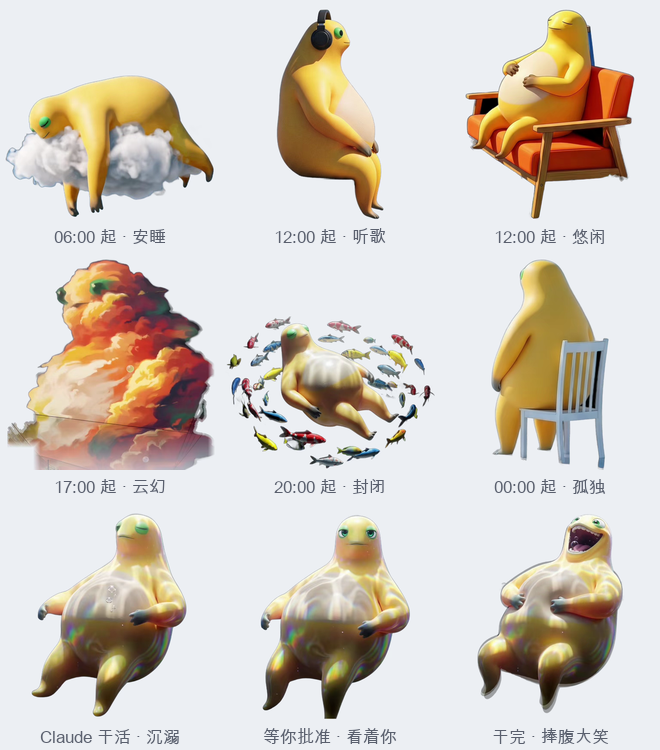
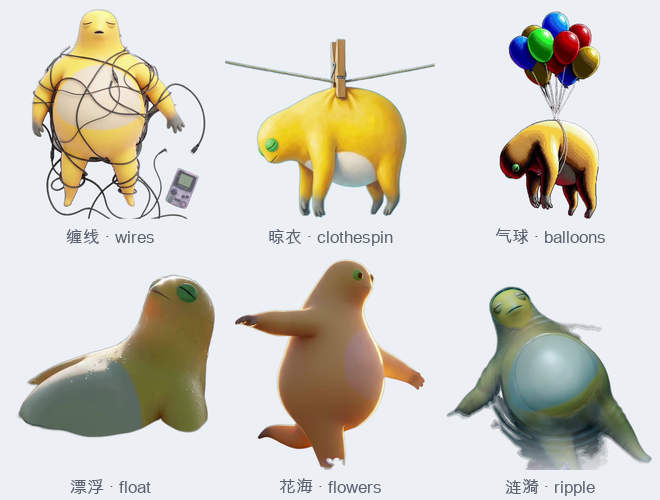

# 奶蛙桌宠 naiwa-pet

一只住在 Mac 桌面角落、跟着 Claude Code 干活的奶蛙。画是 B 站 UP 主 [防御老猫](https://space.bilibili.com/3546757950605988) 画的艺术奶蛙（作者同意免费开源使用）。空闲时它按一天的时段换一只，在那里慢慢地动；Claude 一开工，它沉进水里闭着眼专心干活；Claude 要你批准时，它睁开眼转过来看着你；活干完了，它捧腹大笑。

原生 Swift，整个 App 约 14MB，没有声音，不抢焦点，不花 token。

<p align="center"></p>

## 各种样子



| 什么时候 | 奶蛙 |
|---|---|
| 空闲，早上 6 点起 | **安睡**：趴在一朵云上睡觉，跟着呼吸轻轻起伏 |
| 空闲，中午 12 点起 | **听歌**（戴着耳机坐着）和**悠闲**（靠在橙色沙发上晒太阳）轮流出来 |
| 空闲，傍晚 5 点起 | **云幻**：晚霞里一团云做的奶蛙，云在慢慢翻涌 |
| 空闲，晚上 8 点起 | **封闭**：躺着浮在半空，一圈小鱼绕着它 |
| 空闲，0 点以后 | **孤独**：背对你扶着一把椅子，望着远方 |
| Claude 在干活 | **沉溺**：闭着眼悬浮在水里，水光在身上流动 |
| Claude 等你批准（要权限、MCP 弹窗问你） | 沉溺奶蛙睁开眼，转过来看着你，头顶「my-repo 等你批准 Bash」；你处理完它接着沉进去干 |
| 干完一个活（这一轮跑满 1 分钟，且读写过文件或跑过命令） | **捧腹大笑**，头顶「my-repo 做完了 · 4 分 12 秒」 |
| 只聊了几句 / 说完话没理它 | 不打扰 |
| 你摸它、点它 | 也笑 |

### 还能挑这些

默认安排里没用到，右键 →「空闲时」/「干活时」勾上就会出来（比如干活时换成被数据线缠住的那只）：



## 特色

- **好看**：画全部来自防御老猫的《艺术奶娃》系列，是原汁原味的奶蛙，不穿衣服不换脸。会动的部分用豆包 Seedance 让原画动起来、再逐帧抠出来；审核不让生成的几张，直接在原画上做呼吸、漂浮这类轻微的动作。一共 13 只，默认用其中 7 只，剩下的自己挑。
- **跟着时间换，也能自己挑**：默认早上、中午、傍晚、晚上、深夜各是不同的一只；每个时段出来哪几只、干活时是哪只，右键就能换，见下面「换成你喜欢的」。
- **小**：原生 Swift + AppKit，没有 Electron、没有第三方依赖，App 约 14MB（13 只奶蛙的透明视频）。只在看得见的时候播：被别的窗口挡住、屏幕睡了就停。
- **懂 Claude Code**：给每个会话单独记账，只有真干完一个活才笑，聊两句不打扰；同时开好几个会话，气泡会标出是哪个项目。判断全在本地，不调模型、不花 token，每次钩子约 5 毫秒。
- **不打扰**：没有声音，没有 Dock 图标，点它不会抢走焦点，透明的地方鼠标直接穿过去，不挡你点后面的窗口。
- **只动它该动的配置**：接入 Claude Code 时只往 `settings.json` 里插几条，写之前逐字段核对其他内容完全不变，一条命令就能撤掉。

## 安装

需要 macOS 13 以上，以及 Command Line Tools（没装的话运行 `xcode-select --install`）。不需要 Xcode。

```bash
git clone git@github.com:wangfan1998-github/naiwa-pet.git
cd naiwa-pet
scripts/install.sh       # 编译并装好：~/Applications/Naiwa.app，命令 ~/.local/bin/naiwa，登录时自动出现
naiwa hooks install      # 接入 Claude Code
naiwa demo               # 演示一遍所有样子
```

- 奶蛙默认待在屏幕右下角、Dock 上方，拖动可以换位置，它会记住。
- 如果提示 `~/.local/bin` 不在 PATH 里，按提示把那一行加进 `~/.zshrc`。
- 接入后对新的 Claude Code 会话生效；已经开着的会话一般也会马上生效，没反应就重开一下。
- 是从源码本地编译的，不经过下载，所以不会被 macOS 的「无法验证开发者」拦住。

卸载：`scripts/uninstall.sh`。它会撤掉 Claude Code 接入、关掉奶蛙，并删掉 App、命令、登录自启、偏好设置和 `~/.config/naiwa/config.json`。

## 用法

| 操作 | 效果 |
|---|---|
| 点一下，或者在它身上来回蹭几下 | 捧腹大笑 |
| 拖动 | 换位置 |
| 右键 | 笑一下 / 大小 / 空闲时（每个时段出来哪几只）/ 干活时（是哪只）/ 打开画师主页 / 让它走 |
| `naiwa demo` | 演示：空闲 → 干活 → 等你批准 → 干完大笑 |
| `naiwa laugh` | 笑一下 |
| `naiwa pets` | 有哪几只奶蛙、现在哪个时段出来哪几只 |
| `naiwa` | 把它叫出来（右键「让它走」之后，`naiwa laugh` 不会再把它叫回来） |
| `naiwa quit` | 关掉 |
| `naiwa hooks install` / `uninstall` | 接入 / 撤掉 Claude Code |

改「干完一个活」的门槛（默认 60 秒）：

```bash
defaults write com.nwverse.naiwa bigSeconds -float 30
```

## 换成你喜欢的

上面那张表只是默认安排。每个人喜欢的不一样，可以自己换：

- **右键 →「空闲时」**：每个时段一行，点进去勾上 / 去掉奶蛙。一个时段勾了几只，每回到空闲轮流出来一只；至少留一只。
- **右键 →「干活时」**：选 Claude 干活时是哪只。等你批准、干完大笑还是沉溺奶蛙（只有它有这两段）。
- **改时段的起止时间**：右键 →「空闲时」→「改时段的起止时间…」，会打开 `~/.config/naiwa/config.json`，改完保存就生效，不用重启：

```json
{
  "idle": [
    {"from": 0, "pets": ["lonely"]},
    {"from": 6, "pets": ["sleep"]},
    {"from": 12, "pets": ["listen", "relax"]},
    {"from": 17, "pets": ["cloud"]},
    {"from": 20, "pets": ["fish"]}
  ],
  "work": "immerse"
}
```

`from` 是这个时段从几点开始（0–23），到下一个时段的 `from` 为止；时段可以加、可以删。`pets` 里填的名字用 `naiwa pets` 查。写错的名字、写坏的时段会被忽略，用回默认。这个文件可以直接发给别人用。不想要了：右键 →「空闲时」→「恢复默认」，或者删掉这个文件。

## 和 Claude Code 怎么对上的

`naiwa hooks install` 在 `~/.claude/settings.json` 的六个事件里各加一条 `naiwa hook`，每次触发时把事件转给奶蛙：

| 事件 | 奶蛙记下什么 |
|---|---|
| `UserPromptSubmit` | 这一轮开始了，开始计时 |
| `PreToolUse` / `PostToolUse` | 动了工具；要是刚才在等你批准，说明你批准了 |
| `Notification` | 看 `notification_type`：`permission_prompt`、`elicitation_dialog`、`agent_needs_input` 算「等你」；`idle_prompt`（说完 60 秒你没理它）等其他提醒不算 |
| `Stop` | 这一轮结束：跑满门槛并且动过工具就笑，否则什么都不做 |
| `SessionEnd` | 会话关了，不再记它 |

已知局限：Claude 中途停下来等后台任务、或者停下来问你问题，从事件上看和「做完了」一样，只要时长够、动过工具也会笑。

**Codex**：只能接 `notify`，它只在一轮结束时通知，所以只能做到「做完就笑」，没有干活、等你这些状态。在 `~/.codex/config.toml` 最上面加 `notify = ["/Users/你/.local/bin/naiwa", "laugh"]`。Codex 只认一个 notify，已经有的话要自己串起来。

**其他命令行**：长任务后面接一句就行，比如 `make build; naiwa laugh`。

## 素材怎么来的

画是防御老猫在 B 站动态里分享的《艺术奶娃》（竖版 1536×2752，作者写明「可随意分享」）。每段怎么做的、用了哪张画、提示词是什么，都写在 [`art/pets.json`](art/pets.json) 里：

```
原画 → 裁成奶蛙居中、占满画面的方图
     → 豆包 Seedance 2.5 图生视频（5 秒、1:1），提示词只要求很轻的动作，最后一帧接回第一帧
       （安睡、听歌、封闭、孤独、花海被 Seedance 内容审核拒绝，改成在原画上做呼吸、漂浮、小鱼来回转）
     → scripts/make_art.py：rembg 逐帧抠图 → 清理透明度 → 循环片段首尾叠化
       → 同一只奶蛙的几段共用一个裁剪框 → 预乘透明度编成带透明通道的 HEVC（assets/*.mov）
```

| 片段 | 原画 | 用在 |
|---|---|---|
| sleep | 安睡奶蛙 | 早上 6 点起的空闲 |
| listen / relax | 听歌奶蛙 / 悠闲奶蛙 | 中午 12 点起的空闲，两只轮流 |
| cloud | 云幻奶蛙 | 傍晚 5 点起的空闲 |
| fish | 封闭奶蛙 | 晚上 8 点起的空闲 |
| lonely | 孤独奶蛙 | 0 点以后的空闲 |
| immerse / look / laugh | 沉溺奶蛙 | 干活 / 等你批准 / 干完大笑 |
| wires / clothespin / balloons / float / flowers / ripple | 007、037、024、019、008、003 号 | 默认没用，右键菜单里挑 |

- 抠图用 rembg 的 `isnet-general-use`。它会把反光的肚皮当成半透明（放在深色桌面上发灰），也会留下栏杆、阴影的零碎小块，`make_art.py` 里把身体内部补实、把和身体不连着的小块去掉（身边本来就有小鱼、云朵的那几只不去）。蓝天前面的白肚皮它会隔几十帧漏掉一次，背景是一整片纯色的片段再按背景色补一刀（`key`）。
- 状态之间是硬切：两个透明画面叠化会出重影。干活、等你、做完是同一只沉溺奶蛙，用同一个裁剪框，切过去不跳。
- 试过但放弃的：整幅画做成桌面角落的小画框（奶蛙戴帽子背吉他，不像奶蛙）；原版《奶蛙大笑》视频抠图（480P，糊、不够好看）；自己拿 3D 模型做动作（笑起来不像）；带声音（太吵）。

### 版权

- 画：[防御老猫](https://space.bilibili.com/3546757950605988)（B 站）。作者同意本项目免费开源使用，使用时必须署名（App 右键菜单和本页都有），作者要求下架就删。
- 奶蛙这个形象另有权利人（官方作者设计师李想，milkyfrog.com「保留所有权利」）。本项目不收费、**不要商用**。

## 开发

```bash
swift build -c release
NAIWA_ASSETS=$PWD/assets .build/release/naiwa      # 直接跑，不用打包
scripts/build_app.sh                               # 打包 build/Naiwa.app（Intel + Apple 芯片通用）

# 重新生成素材（需要 ffmpeg、rembg）：原片目录里放 Seedance 出的 <src>.mp4 和裁好的原画 <src>.png，名字见 art/pets.json
python3 scripts/make_art.py <原片目录>              # 也可以只处理几段：... <原片目录> cloud fish
```

代码在 `Sources/naiwa/`：

- `Pet.swift`：窗口、状态机（笑 > 等你 > 干活 > 空闲）、按时段换空闲的奶蛙、看不见时停播、鼠标交互
- `Sessions.swift`：按钩子事件给每个会话记账，判断状态和这一轮值不值得笑
- `Assets.swift`：读素材（有哪几只、默认安排），播放片段（系统硬件解码后按帧取出贴到图层）
- `Schedule.swift`：用户自己的安排（`~/.config/naiwa/config.json`）：哪个时段出来哪几只、干活时是哪只
- `Bubble.swift`：头顶气泡
- `Link.swift`：命令行和桌宠之间的通道（具名 CFMessagePort，顺带保证只有一只），以及 `naiwa hook` / `demo` 和偏好设置
- `Hooks.swift`：`naiwa hooks install / uninstall`

灵感来自 [dsh-pet](https://github.com/PC2005-cloud/dsh-pet)（没有使用它的代码和素材）。
