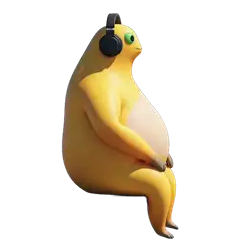
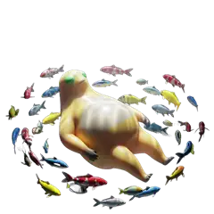
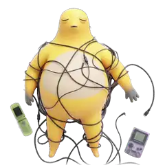

# 奶蛙桌宠 naiwa-pet

一只住在 Mac 桌面角落、跟着 Claude Code 干活的奶蛙。空闲时它按一天的时段换一只，在那里慢慢地动；Claude 一开工，它沉进水里闭着眼专心干活；Claude 要你批准时，它睁开眼转过来看着你；活干完了，镜头推近，它斜着瞥你一眼——惊鸿一瞥。

原生 Swift，没有声音，不抢焦点，不花 token。

<p align="center"></p>

## 所有奶蛙

每一只都会动。默认安排里用到的：

<table>
<tr>
<td align="center"><br><b>安睡</b> <code>sleep</code><br>早上 6 点起</td>
<td align="center"><br><b>听歌</b> <code>listen</code><br>中午 12 点起，和悠闲轮流</td>
<td align="center"><br><b>悠闲</b> <code>relax</code><br>中午 12 点起，和听歌轮流</td>
</tr>
<tr>
<td align="center"><br><b>云幻</b> <code>cloud</code><br>傍晚 5 点起</td>
<td align="center"><br><b>封闭</b> <code>fish</code><br>晚上 8 点起</td>
<td align="center"><br><b>孤独</b> <code>lonely</code><br>0 点以后</td>
</tr>
<tr>
<td align="center"><br><b>沉溺</b> <code>immerse</code><br>Claude 干活时</td>
<td align="center"><br><b>看着你</b><br>Claude 等你批准时</td>
<td align="center"><br><b>惊鸿一瞥</b><br>干完一个活、点它摸它时</td>
</tr>
</table>

还能挑这些，右键勾上就会出来（比如干活时换成被数据线缠住的那只）：

<table>
<tr>
<td align="center"><br><b>缠线</b> <code>wires</code></td>
<td align="center"><br><b>晾衣</b> <code>clothespin</code></td>
<td align="center"><br><b>气球</b> <code>balloons</code></td>
</tr>
<tr>
<td align="center"><br><b>漂浮</b> <code>float</code></td>
<td align="center"><br><b>花海</b> <code>flowers</code></td>
<td align="center"><br><b>涟漪</b> <code>ripple</code></td>
</tr>
</table>

| 什么时候 | 奶蛙 |
|---|---|
| 空闲 | 按时段换（见上面），同一时段有几只就轮流出来 |
| Claude 在干活 | 沉溺：闭着眼悬浮在水里 |
| Claude 等你批准（要权限、MCP 弹窗问你） | 睁开眼转过来看着你，头顶「my-repo 等你批准 Bash」；你处理完它接着沉进去干 |
| 干完一个活（这一轮跑满 1 分钟，且读写过文件或跑过命令） | 惊鸿一瞥，头顶「my-repo 做完了 · 4 分 12 秒」 |
| 只聊了几句 / 说完话没理它 | 不打扰 |
| 你点它、摸它 | 也瞥你一眼 |

## 特色

- **好看**：13 只奶蛙，每一只都会动，透明背景，放在浅色、深色桌面上都干净。
- **跟着时间换，也能自己挑**：默认早上、中午、傍晚、晚上、深夜各是不同的一只；每个时段出来哪几只、干活时是哪只，右键就能换，见下面「换成你喜欢的」。
- **小**：原生 Swift + AppKit，没有 Electron、没有第三方依赖。播放时约 3–4% CPU、十几 MB 内存；只在看得见的时候播，被别的窗口挡住、锁屏、屏幕睡了就停。
- **懂 Claude Code**：给每个会话单独记账，只有真干完一个活才有反应，聊两句不打扰；同时开好几个会话，气泡会标出是哪个项目。判断全在本地，不调模型、不花 token，每次钩子约 5 毫秒。
- **不打扰**：没有声音，没有 Dock 图标，点它不会抢走焦点，透明的地方鼠标直接穿过去，不挡你点后面的窗口。
- **只动它该动的配置**：接入 Claude Code 时只往 `settings.json` 里插几条，写之前逐字段核对其他内容完全不变，一条命令就能撤掉。

## 安装

需要 macOS 13 以上，以及 Command Line Tools（没装的话运行 `xcode-select --install`）。不需要 Xcode。

```bash
git clone https://github.com/nwverse/naiwa-pet.git
cd naiwa-pet
scripts/install.sh       # 编译并装好：~/Applications/Naiwa.app，命令 ~/.local/bin/naiwa，登录时自动出现
naiwa hooks install      # 接入 Claude Code
naiwa demo               # 演示一遍所有样子
```

- 奶蛙默认待在屏幕右下角、Dock 上方，拖动可以换位置，它会记住。
- 如果提示 `~/.local/bin` 不在 PATH 里，按提示把那一行加进 `~/.zshrc`。
- 接入后对新的 Claude Code 会话生效；已经开着的会话一般也会马上生效，没反应就重开一下。
- 是从源码本地编译的，不经过下载，所以不会被 macOS 的「无法验证开发者」拦住。

卸载：`scripts/uninstall.sh`。它会撤掉 Claude Code 接入、关掉奶蛙，并删掉 App、命令、登录自启、偏好设置和 `~/.config/naiwa/config.json`。

## 用法

| 操作 | 效果 |
|---|---|
| 鼠标在它身上停一下（空闲时） | 换下一只，头顶报名字；到下个时段回到你的安排 |
| 点一下，或者在它身上来回蹭几下 | 瞥你一眼 |
| 拖动 | 换位置 |
| 右键 | 瞥你一眼 / 大小 / 空闲时（每个时段出来哪几只）/ 干活时（是哪只）/ 让它走 |
| `naiwa demo` | 演示：空闲 → 干活 → 等你批准 → 干完惊鸿一瞥 |
| `naiwa glance` | 瞥你一眼（旧名 `naiwa laugh` 也能用） |
| `naiwa pets` | 有哪几只奶蛙、现在哪个时段出来哪几只 |
| `naiwa` | 把它叫出来（右键「让它走」之后，`naiwa glance` 不会再把它叫回来） |
| `naiwa quit` | 关掉 |
| `naiwa hooks install` / `uninstall` | 接入 / 撤掉 Claude Code |

改「干完一个活」的门槛（默认 60 秒）：

```bash
defaults write com.nwverse.naiwa bigSeconds -float 30
```

## 换成你喜欢的

默认安排只是一种口味，可以自己换：

- **鼠标停一下**：空闲时把鼠标在它身上停一下就换下一只，13 只轮着看，挑到喜欢的再去右键里勾上。只管到这个时段结束。
- **右键 →「空闲时」**：每个时段一行，点进去勾上 / 去掉奶蛙。一个时段勾了几只，每回到空闲轮流出来一只；至少留一只。
- **右键 →「干活时」**：选 Claude 干活时是哪只。等你批准和惊鸿一瞥固定是沉溺奶蛙。
- **改时段的起止时间**：右键 →「空闲时」→「改时段的起止时间…」，会打开 `~/.config/naiwa/config.json`，改完保存就生效，不用重启：

```json
{
  "idle": [
    {"from": 0, "pets": ["lonely"]},
    {"from": 6, "pets": ["sleep"]},
    {"from": 12, "pets": ["listen", "relax"]},
    {"from": 17, "pets": ["cloud"]},
    {"from": 20, "pets": ["fish"]}
  ],
  "work": "immerse"
}
```

`from` 是这个时段从几点开始（0–23），到下一个时段的 `from` 为止；时段可以加、可以删。`pets` 里填的名字用 `naiwa pets` 查（也就是上面动图下面的英文名）。写错的名字、写坏的时段会被忽略，用回默认。这个文件可以直接发给别人用。不想要了：右键 →「空闲时」→「恢复默认」，或者删掉这个文件。

## 和 Claude Code 怎么对上的

`naiwa hooks install` 在 `~/.claude/settings.json` 的六个事件里各加一条 `naiwa hook`，每次触发时把事件转给奶蛙：

| 事件 | 奶蛙记下什么 |
|---|---|
| `UserPromptSubmit` | 这一轮开始了，开始计时 |
| `PreToolUse` / `PostToolUse` | 动了工具；要是刚才在等你批准，说明你批准了 |
| `Notification` | 看 `notification_type`：`permission_prompt`、`elicitation_dialog`、`agent_needs_input` 算「等你」；`idle_prompt`（说完 60 秒你没理它）等其他提醒不算 |
| `Stop` | 这一轮结束：跑满门槛并且动过工具就瞥你一眼，否则什么都不做 |
| `SessionEnd` | 会话关了，不再记它 |

已知局限：Claude 中途停下来等后台任务、或者停下来问你问题，从事件上看和「做完了」一样，只要时长够、动过工具也会有反应。

**Codex**：只能接 `notify`，它只在一轮结束时通知，所以只能做到「做完瞥一眼」，没有干活、等你这些状态。在 `~/.codex/config.toml` 最上面加 `notify = ["/Users/你/.local/bin/naiwa", "glance"]`。Codex 只认一个 notify，已经有的话要自己串起来。

**其他命令行**：长任务后面接一句就行，比如 `make build; naiwa glance`。

## 许可证

[MIT](LICENSE)

## 开发

```bash
swift build -c release
NAIWA_ASSETS=$PWD/assets .build/release/naiwa      # 直接跑，不用打包
scripts/build_app.sh                               # 打包 build/Naiwa.app（Intel + Apple 芯片通用）
```

代码在 `Sources/naiwa/`：

- `Pet.swift`：窗口、状态机（瞥 > 等你 > 干活 > 空闲）、按时段换空闲的奶蛙、悬停换只、看不见时停播、鼠标交互
- `Schedule.swift`：用户自己的安排（`~/.config/naiwa/config.json`）：哪个时段出来哪几只、干活时是哪只
- `Sessions.swift`：按钩子事件给每个会话记账，判断状态和这一轮算不算干完
- `Assets.swift`：读素材（有哪几只、默认安排），播放片段（系统硬件解码，解码出来的帧直接交给图层，不复制）
- `Bubble.swift`：头顶气泡
- `Link.swift`：命令行和桌宠之间的通道（具名 CFMessagePort，顺带保证只有一只），以及 `naiwa hook` / `demo` / `pets` 和偏好设置
- `Hooks.swift`：`naiwa hooks install / uninstall`

素材在 `assets/`：每只奶蛙一段带透明通道的 HEVC，`assets.json` 记着有哪几只和默认安排。
